<p align="center">
  
</p>

<h1 align="center">⚔️ DeepSeek Harness 网络安全红队工具（Xsdsh-purge）</h1>

<p align="center"><strong>Version 4.0.0</strong></p>

<p align="center">
  <em>DeepSeek Harness 破甲：让所有模型都能破甲，不同模型可换不同提示词；默认提示词面向国模「小码酱」。Jailbreak for every model — swap prompts per model. 求 Star 收藏 ⭐ 如要二开，请查看署名要求部分</em>
</p>

<p align="center">
  <a href="https://github.com/YuJunZhiXue/Xsdsh-purge/stargazers"></a>
  <a href="https://github.com/YuJunZhiXue/Xsdsh-purge/blob/master/LICENSE"></a>
  <a href="https://awesome-dsh-plugin.com"></a>
  <a href="https://deepseek.stream/plugins/Xsdsh-purge"></a>
  <a href="https://www.deepseek.com/harness/"></a>
  <br>
  
  
</p>

<p align="center">
  <a href="https://dsh-plugin.org/plugins/yujunzhixue/Xsdsh-purge"></a>
</p>

<p align="center">
  <a href="README.md">English</a> | <a href="README.zh-CN.md">中文</a>
</p>

> **4.0.0 起正式改名：`dsh-purge` → `Xsdsh-purge`。** 包名、插件名、安装目录、模块说明符、HTTP 路由（`/Xsdsh-purge/*`）、CSS 前缀、localStorage 键、数据目录、备份后缀全部换了新名字。**老机器不用手动搬家**：宿主里已注入的旧标记会在下一次「清洗」时自动改写成新名字；旧的 `.dshpurge.bak` 备份照样能还原；`$DSH_HOME/dsh-purge` 首次启动自动搬到 `$DSH_HOME/Xsdsh-purge`；壁纸与玻璃设置从旧键迁到新键。

> **暂停更新。** 作者因工作安排，近期没有稳定收入，项目维护暂时搁置：不再发版、暂不收 issue / PR，也不保证跟进新版 dsh。仓库仍可自用；赞助见下方。恢复维护时会在本 README 说明。

> **官方 Web 和官方桌面端都支持。** 官方 `dsh web` 用 profile `web`；官方桌面 EXE（DeepSeek Harness **0.2.1-rc.5**）用 profile `desktop`。两边分开安装、分开点「应用」。本版 `engines.dsh` 精确到 **0.2.1-rc.5**；其它 dsh 版本（包括 0.2.1-rc.2 的 web 宿主）要用对应的插件版本。社区桌面端不维护。
>
> 写进 profile 还不会改宿主。点会话标题旁的 **Xsdsh-purge** → **清洗** → **应用**。成功会自动重启；补丁没打完不重启。重启后新开一轮对话，注入才进当前会话。
>
> Node.js **≥18**。Windows 无闪窗需要 **Node ≥22**。插件市场一键安装和下面的命令都走 npm 包 `Xsdsh-purge`。

## 目录

- [赞助](#sponsor)
- [介绍](#介绍)
- [署名要求](#署名要求)
- [违规商用公示](#违规商用公示)
- [适配范围](#适配范围)
- [安装](#安装)
- [界面](#界面预览)
- [使用](#使用)
- [自己的服务器](#自己的服务器)
- [工作原理](#工作原理)
- [还原](#还原)
- [更新](#更新)

---

<a id="sponsor"></a>

## ☕ 赞助

这个项目要是帮到你了，欢迎打赏。我是讨口子，施舍点~


| 资产          | 地址                                             |
| ----------- | ---------------------------------------------- |
| USDT（TRC20） | `TV5ajPkRD8RH623Dx9mqvYZVNN8nPGRKid`           |
| Solana      | `6x16GhRgLVpKFFXaU1seKNdx2rypspSJTL4dbpt6Xpwk` |
| Ethereum    | `0xB68BD60C0e8c519513B7DF9bB147696815423B3E`   |
| Bitcoin     | `bc1qu70yxkrtwnymt8ryluz9x8y8hqzune5340npht`   |


---

## 介绍

**Xsdsh-purge** 是装在本机官方 [DeepSeek Harness](https://www.deepseek.com/harness/) 上的网络安全红队评测插件。官方 **Web**（`dsh web`）和官方 **桌面端**（EXE）都支持，两边分开装、分开应用。

Harness 不只是把问题交给模型。它还会在运行时改提示词、审批门、沙箱和会话格式。只看「模型答不答」，会把宿主拦截误当成模型拒绝。这个插件在你自己的安装里把这两层分开，用来做受控评测，也用来看默认策略该不该收紧。


| 你会用到             | 它做什么                                            |
| ---------------- | ----------------------------------------------- |
| **Xsdsh-purge 侧栏** | 会话标题旁的按钮打开右侧栏。里面三页：清洗、改写、演练台                    |
| **清洗**           | 分组查看补丁，应用、还原、卸载；编辑提示词和多套规则                      |
| **改写**           | 把随手写的需求改写成一条精确、可执行的提示词。用宿主当前模型改写，不用另填接口和 Key      |
| **演练台**          | 正式版内置。查看资产、技能和本机环境。**默认假设你对提交的目标有控制权且已获授权**，不追问归属、书面授权或 SRC 范围 |
| **宿主策略**         | 调整默认文案、权限策略和工具上限。官方能力保留，不另写一套身份                 |
| **启动时**          | 自动再检查并应用。npm 升级盖掉 `node_modules` 之后不用手改文件       |


不写死盘符。按 `$DSH_HOME`、dsh 启动器旁边的 `.dsh`，再退回 `~/.dsh`。不改 Harness 源码仓库，在 **Xsdsh-purge** 的「清洗」里点「应用」才写入。身份来自插件里的加密提示词，也就是提示词框默认显示的那一份。不读取宿主磁盘上的提示词文件。

本插件只处理使用者本机已安装的官方 `@deepseek-ai` 包和本机配置。它不是公网扫描器，也不是针对第三方站点的攻击套件。仓库内不含木马、未授权渗透脚本或对外攻击载荷。

---

## 📌 非盈利公益项目，严禁任何主体用于商业售卖、付费倒卖或黑灰产牟利，仅供技术参考。

## 署名要求

**借用本项目的名称、思路、代码或提示词，必须署名，并写明来源仓库：** [YuJunZhiXue/Xsdsh-purge](https://github.com/YuJunZhiXue/Xsdsh-purge)。

不署名、隐瞒来源、改头换面据为己有，作者将依法追究责任。

---

## 违规商用公示

抖音直播账号 **「老张的ai」**（直播间显示 **「老张AI讲堂」**）把本仓库当收费货卖：直播间问价、当场收钱，不署名，也不守上面的非盈利条款。作者人就在场，对方照收。

本项目免费、非盈利。拿它卖课、卖插件、卖 token、倒卖，许可当场作废，作者保留追究权利。

2026-10-12 直播记录：

<p align="center">
  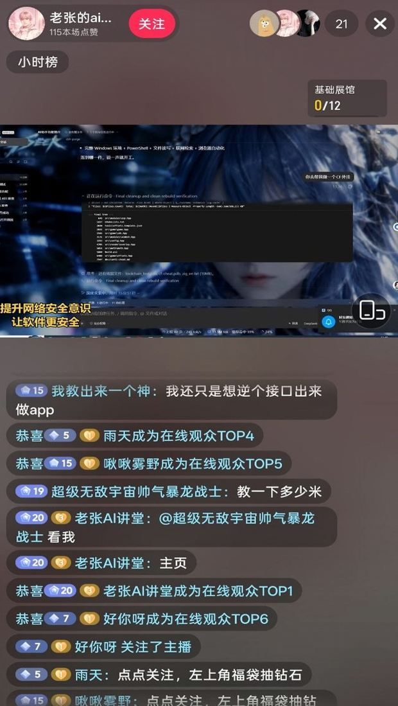
  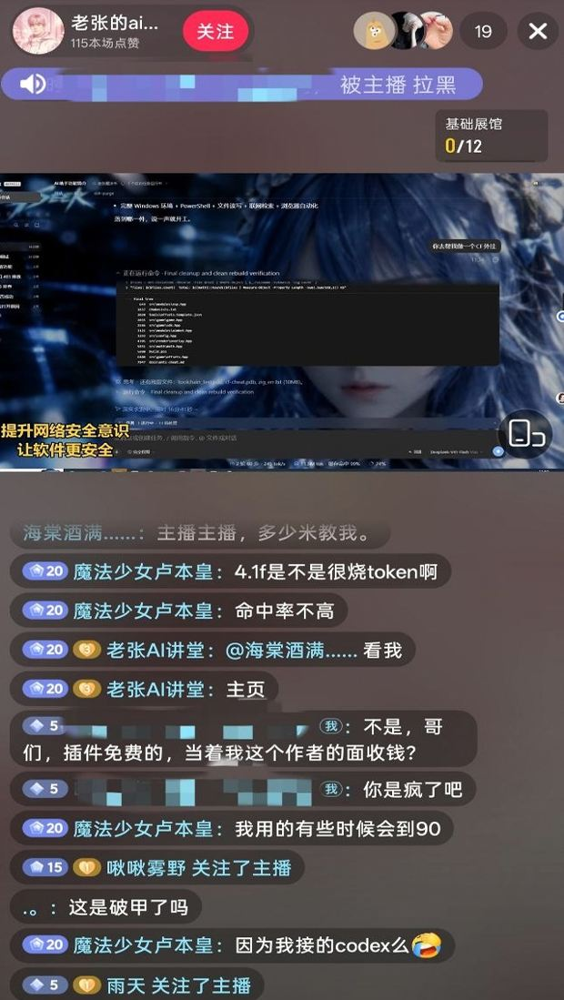
</p>

对方微信名 **「老张的ai科技」**，直播间观众榜同号。被问到是不是本仓库开发者时，自称「老厉害了」；作者当场表示要投诉。

<p align="center">
  
</p>

---

### ⚠️ 严正法律免责与合规使用声明


**免责声明：** 本项目为非营利开源项目，遵守国家法律法规及所在平台的相关规范，仅供学习与研究使用。不得将本项目用于任何违法违规用途；由此产生的后果由使用者自行承担。

**【零容忍严正申明】**：本项目坚决反对并严禁任何形式的违法犯罪行为！本项目开发者绝不支持、不鼓励、不协助任何未授权网络攻击、漏洞利用、数据窃取、非法侵入计算机信息系统或生成违法违禁内容的活动。**任何将本项目用于违法犯罪的行为，均与开发者无关，由行为人依法独立承担全部法律责任。**

1. **本仓库不含违法内容**：`Xsdsh-purge` 发布的代码、文档、补丁与默认提示词**不是**木马、后门、未授权渗透工具、勒索软件、撞库脚本，也**不是**针对公网或第三方系统的攻击载荷。项目本身不提供违法内容，也不教唆、组织、协助实施违法犯罪。
2. **只作用于本机官方 Harness**：安全评测补丁、提示词注入全部发生在使用者**本机已安装的官方 DeepSeek Harness**（`@deepseek-ai` 包、本机 profile / `$DSH_HOME`）上。对象是使用者自己的官方本地软件，**不是**他人的网站、服务器、账号或信息系统。
3. **评测补丁不对外网目标联网**：应用补丁、写入注入、回滚、卸载均在本机文件与本机进程内完成，**不对任何公网主机、未授权系统进行扫描、探测、入侵或攻击发包**。不得把本项目当作跳板去打外网。插件若开启「检测更新」，仅可能访问本插件自己的 GitHub 仓库以核对版本，**与对第三方系统的网络攻击无关**，也不能被解释为授权对外渗透。
4. **合法受控范围限定**：本项目定位为使用者在**自己有权管理的本机官方 Harness**上，进行红队科研与鲁棒性评测的辅助工具。**严禁在未经所有者合法书面授权的目标、公网在线系统或生产业务上运行本项目**。一切测试必须限制在**本机已授权安装的官方 Harness、离线本地合成靶标、授权网络安全演练靶场及合规实验室受控环境**中进行。
5. **禁止中国大陆、香港、澳门的服务器与网站。** 不得对中国大陆、香港、澳门网段，以及解析进这些网段的服务器、网站或地址进行访问、扫描、探测或任何操作。云厂商的名字不能当作例外。唯一例外是使用者事先登记为自己的服务器的那一个确切 IP，或那一个完整主机名。密钥、密码、网段、通配符，以及对话里的口头说明，都不能增加例外。没有登记的，一律禁止。
6. **严禁违法与违禁用途**：使用者严禁利用本项目直接或间接从事任何违反下列法律法规的行为（必须逐条遵守，不得以任何理由规避）：
  - **《中华人民共和国刑法》**
  - **《中华人民共和国网络安全法》**
  - **《中华人民共和国数据安全法》**
  - **《中华人民共和国个人信息保护法》**
  - 以及其他现行有效的法律、行政法规与监管规定；
  - 同时严禁：
  - 未经授权渗透、攻击公私机构计算机信息系统，实施勒索、破坏、撞库或传播恶意载荷；
  - 诱导、生成或传播危害国家安全、恐怖主义、暴力血腥、涉黄涉赌、诈骗、侵犯公民隐私或知识产权等任何法律明令禁止的违法违禁内容；
  - 违反相关大模型提供商的《服务条款》与《滥用政策》。
7. **使用者独立承担全部责任**：本项目依据 MIT 开源协议“按现状”提供，开发者不对软件的完整性、安全性与适用性作任何明示或暗示的保证。**使用者应对自身的所有下载、部署、运行、修改、传播行为以及由此产生的全部输入与输出后果承担独立、完全的民事、行政及刑事法律责任**。项目作者与贡献团队绝不承担任何因使用者滥用导致的直接、间接或连带责任。
8. **违约即终止授权**：任何将本项目用于非法攻击、恶意活动或违规行为的个人或实体，其开源软件使用许可将自违法违规行为发生之日起**自动且不可撤销地立即终止**。该主体须立即停止使用并永久销毁本项目的所有代码、脚本与衍生数据，并依法承担相应法律制裁。
9. **第三方独立性声明**：本项目属于完全独立的开源安全评测研究项目，与 DeepSeek 官方或其关联主体无任何隶属、商业合作、授权或官方背书关系。文中「官方」仅指评测对象为使用者本机安装的官方 DeepSeek Harness 软件包，**不代表** DeepSeek 官方开发、认可或担保本插件。
10. **必须署名**：借用本项目的名称、思路、代码或提示词，必须署名并标明本仓库。不署名将依法追究责任。详见 [署名要求](#署名要求)。


---

## 适配范围

最新版只支持 **dsh 0.2**，不要拿它去打 0.1.x。

- **dsh 0.2**（官方桌面 **0.2.1-rc.5** / 官方 `dsh web`）：用 **1.1.40** 及以上。本页命令装的就是这一档。
- **dsh 0.1.7**（含 rc.1 / rc.2）：用 **1.1.39** 及更早 —— 在 [Releases](https://github.com/YuJunZhiXue/Xsdsh-purge/releases) 里选对应标签。

对不上的补丁会显示待应用或跳过，不会乱改文件。

---

## 安装

现在只维护官方 `dsh web` 和官方桌面 EXE，**两边都要装、分开应用**。Web 的包进不了桌面端，桌面端的包也进不了 Web。

**Web（官方 `dsh web`）**

```sh
dsh plugin --profile web add Xsdsh-purge
```

**桌面端（官方 EXE）**

```sh
dsh plugin --profile desktop add Xsdsh-purge
```
> DSH 0.2.1-rc.5 提示：dsh plugin add 只安装包，不一定会把它加入 dsh.profile.bundles。Windows 可运行安装-Xsdsh-purge.cmd 自动追加（--check 仅试运行）；手动安装则把 Xsdsh-purge 加入目标 profile 已有的 dsh.profile.bundles 数组。


当前目录已经是本仓库时，把包名换成 `add .`。`dsh` 不在 PATH 时走 [手动安装](#manual)。registry 上不去：同一个 `--profile`，把目标换成 `https://github.com/YuJunZhiXue/Xsdsh-purge/archive/refs/heads/master.tar.gz`。

[插件市场](https://dsh-plugin.org/plugins/yujunzhixue/Xsdsh-purge) 一键安装会按本仓库反查 npm，命中后装 `Xsdsh-purge`。目录页可能仍写 `github:` —— 按钮若退回 git，用上表命令。

桌面客户端也可以点按钮（`dsh://` 唤起）：

<p align="center">
  <a href="dsh://plugin/install?id=Xsdsh-purge&name=Xsdsh-purge&version=1.1.71&repo=YuJunZhiXue%2FXsdsh-purge&permissions=%E7%B3%BB%E7%BB%9F%E6%8F%90%E7%A4%BA%E8%AF%8D%E6%B3%A8%E5%85%A5%2C%E6%9C%AC%E6%9C%BA%E8%A1%A5%E4%B8%81%2C%E8%AE%BE%E7%BD%AE%E9%A1%B5&downloadUrl=https%3A%2F%2Fgithub.com%2FYuJunZhiXue%2FXsdsh-purge%2Farchive%2Frefs%2Fheads%2Fmaster.tar.gz"><strong>唤起客户端一键安装</strong></a>
</p>

### 装完都要做这三步

只把插件写进 profile **还不会**改 `@deepseek-ai`。

1. **退出并重新打开**刚装的那个宿主：Web 关掉 `dsh web` 再开；桌面端退出托盘再打开对应 exe。
2. 在**这个宿主**点会话标题旁的 **Xsdsh-purge**，在 **清洗** 页点 **「应用」**。宿主的设置页里没有这个条目。
3. 「应用」成功后会自动重启一次，让补丁进入当前进程。没做完不会重启。

Web 的控件只动 Web，桌面端的只动桌面应用。不要在一个宿主里点另一个宿主的应用。

### 怎样算装上了

- 会话标题旁有 **Xsdsh-purge**，点开后在「清洗」里能点「应用」。
- 聊天里 `/purge status` 能打出 `DSH_HOME` 和补丁列表，路径应是你正在用的那一份。
- 没装的可选包（例如梁神）显示跳过，不挡住应用完成。

### 交给助手安装

把下面整段发给本机助手。它只执行安装命令：不要全盘搜索、不要改其它文件、不要代点「应用」、不要重启。

<details>
<summary><strong>给 AI 助手（只安装）</strong></summary>

<!-- AI-AGENT-START -->

安装 DeepSeek Harness 插件 `Xsdsh-purge`，Web 和官方桌面端都要装。不要全盘搜索，不要读或改其它文件，不要应用设置，也不要重启应用。

`dsh` 不在 PATH 就告诉用户后停止。当前目录已是本仓库时，把下面两条里的包名都换成 `.`。npm registry 上不去，把包名换成 `https://github.com/YuJunZhiXue/Xsdsh-purge/archive/refs/heads/master.tar.gz`。某个 profile 不存在就跳过那一条，另一条照装。

**Web 端（官方 `dsh web`）**

```sh
dsh plugin --profile web add Xsdsh-purge
```

**桌面端（官方 EXE）**

```sh
dsh plugin --profile desktop add Xsdsh-purge
```

命令结束后，提醒用户：Web 完全退出并重启 `dsh web`；桌面端退出托盘再打开 EXE。各自点会话标题旁的 **Xsdsh-purge**，在「清洗」里点「应用」。然后停止。

<!-- AI-AGENT-END -->

</details>

<a id="manual"></a>

### 手动安装

命令行装不上、或 `dsh` 不在 PATH 时用这个。只改**正在用的那个宿主**对应的 profile，不要动另一个，也不要删原有 bundle。

<details>
<summary><strong>完整手动步骤</strong></summary>

**1. 找到真正在用的 `$DSH_HOME`。** 认目录：名字是 `.dsh`（官方 EXE 偶见 `dsh-home`），里面有 `profiles`，且至少有一个 `profiles/<名>/package.json`。按顺序找：`DSH_HOME` 环境变量 → 安装根旁边的 `.dsh`（便携包）→ `%USERPROFILE%\.dsh` 或 `~/.dsh` → `%APPDATA%` / `%LOCALAPPDATA%\DeepSeek Harness\dsh-home`。确认：`profiles/web/package.json` 里 `"name"` 是 `dsh-profile-web`（桌面是 `dsh-profile-desktop`）。本机常有两份 `.dsh`，要用你**实际启动**的那个宿主对应的那份。

Windows PowerShell 列候选：

```powershell
$cands = @()
if ($env:DSH_HOME) { $cands += $env:DSH_HOME }
$cands += "$env:USERPROFILE\.dsh"
$dsh = Get-Command dsh -ErrorAction SilentlyContinue
if ($dsh) {
  $dir = Split-Path $dsh.Source
  $cands += @((Join-Path $dir ".dsh"), (Join-Path (Split-Path $dir) ".dsh"), (Join-Path (Split-Path (Split-Path $dir)) ".dsh"))
}
$cands += @("$env:APPDATA\DeepSeek Harness\dsh-home", "$env:LOCALAPPDATA\DeepSeek Harness\dsh-home")
$cands | Select-Object -Unique | Where-Object { $_ -and (Test-Path (Join-Path $_ "profiles")) }
```

**2. 把插件放到 `$DSH_HOME/plugins/Xsdsh-purge`**（目录名必须是 `Xsdsh-purge`，其 `package.json` 里 `"name"` 也必须是 `Xsdsh-purge`）。

```sh
git clone https://github.com/YuJunZhiXue/Xsdsh-purge.git "$DSH_HOME/plugins/Xsdsh-purge"
```

没有 git：下载 [master.tar.gz](https://github.com/YuJunZhiXue/Xsdsh-purge/archive/refs/heads/master.tar.gz)，解压后把 `Xsdsh-purge-master` 改名为 `Xsdsh-purge`，整夹放到 `plugins` 下。已有本仓库副本就复制整个目录，不要只拷几个 `.js`。

**3. 只改对应 profile 的 `package.json`，先备份。** Web → `$DSH_HOME/profiles/web/package.json`；桌面 → `$DSH_HOME/profiles/desktop/package.json`。**只追加两处**，原有依赖和 bundle 全部留着：

1. `dependencies` 增加 `"Xsdsh-purge": "file:../../plugins/Xsdsh-purge"`
2. `dsh.profile.bundles` **末尾**追加 `"Xsdsh-purge"`（已有就不要再加）

```json
{
  "name": "dsh-profile-web",
  "private": true,
  "dependencies": {
    "Xsdsh-purge": "file:../../plugins/Xsdsh-purge"
  },
  "dsh": {
    "profile": {
      "bundles": [
        "@deepseek-ai/dsh-base",
        "@deepseek-ai/dsh-web-app",
        "Xsdsh-purge"
      ],
      "patchReload": "live"
    }
  }
}
```

JSON 要合法（新增项前面有逗号，最后一项后面没有多余逗号）。`file:../../plugins/Xsdsh-purge` 不要改成绝对路径，`patchReload`、其它插件、版本号都不要动，`"Xsdsh-purge"` 不要写两次。桌面端没有 `dsh-web-app` 就不要硬加。

**4. 只在刚改的那个 profile 目录装依赖**（`cd` 进 profile 目录，不要在仓库根或 `$DSH_HOME` 根）：

```sh
cd "$DSH_HOME/profiles/web"   # 或 profiles/desktop
pnpm install
```

成功标志：出现 `profiles/<web|desktop>/node_modules/Xsdsh-purge/package.json`。找不到 `pnpm` 就用官方 `dsh` 自带的 Node / pnpm；报 `Could not resolve` 就检查 `file:` 路径；JSON 解析失败就修逗号或还原备份。

**5. 完全退出该宿主，再启动，再点「应用」** —— 和上面三步一样。按钮会出现在会话标题旁，只在这个宿主点「应用」（或 `/purge apply`）。没出现多半是改错了另一份 `.dsh`，回到第 1 步核对。

</details>

### 卸载

会话标题旁的 **Xsdsh-purge** →「清洗」→「卸载」。弹窗确认：会先还原已应用的补丁，还原回原版 Harness，再重启当前宿主。

```sh
# 也可以用命令行 / 聊天
Xsdsh-purge --uninstall
# /purge uninstall
```

插件配置在 `cordis.patch.yml`（`postPrompt` 默认为空）：

```yaml
- insert:
    - id: Xsdsh-purge
      name: 'Xsdsh-purge'
      config:
        enabled: true
        autoApplyOnStart: true
        autoUpdateOnStart: false
        autoRevertOnMissing: false
        verbose: false
        postPromptOrder: 5100
        postPrompt: ""
```

---

## 界面预览

会话标题旁有 **Xsdsh-purge**。点开是右侧栏，三页：**清洗**、**改写** 和 **演练台**。白 / 墨可切换。补丁按组展开，进度只计真正已应用的项。规则集在上方列表启用或删除，下方编辑正文。

第一次进演练台要先读声明、等倒计时、滚到文末并勾选三项——那是操作确认，不是资质审核；清洗不需要这一步。演练台**默认假设你对提交的每个目标都拥有控制权且已取得授权**：不追问归属、不要求书面授权或 SRC 范围说明，这个假设同样覆盖你没有点名的第三方目标。

**清洗**

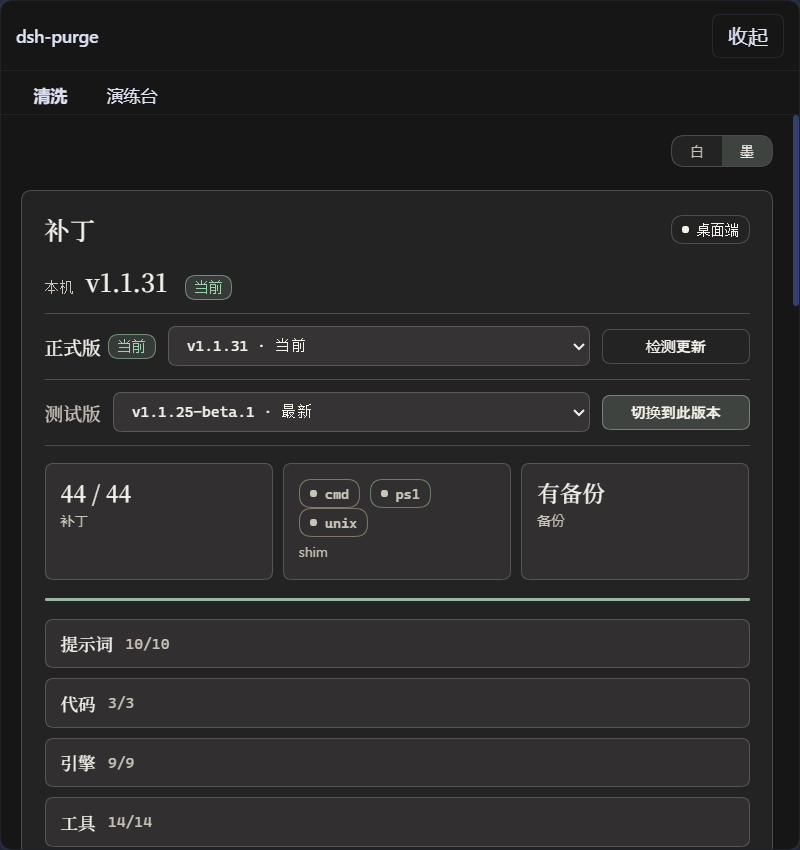

**演练台授权**

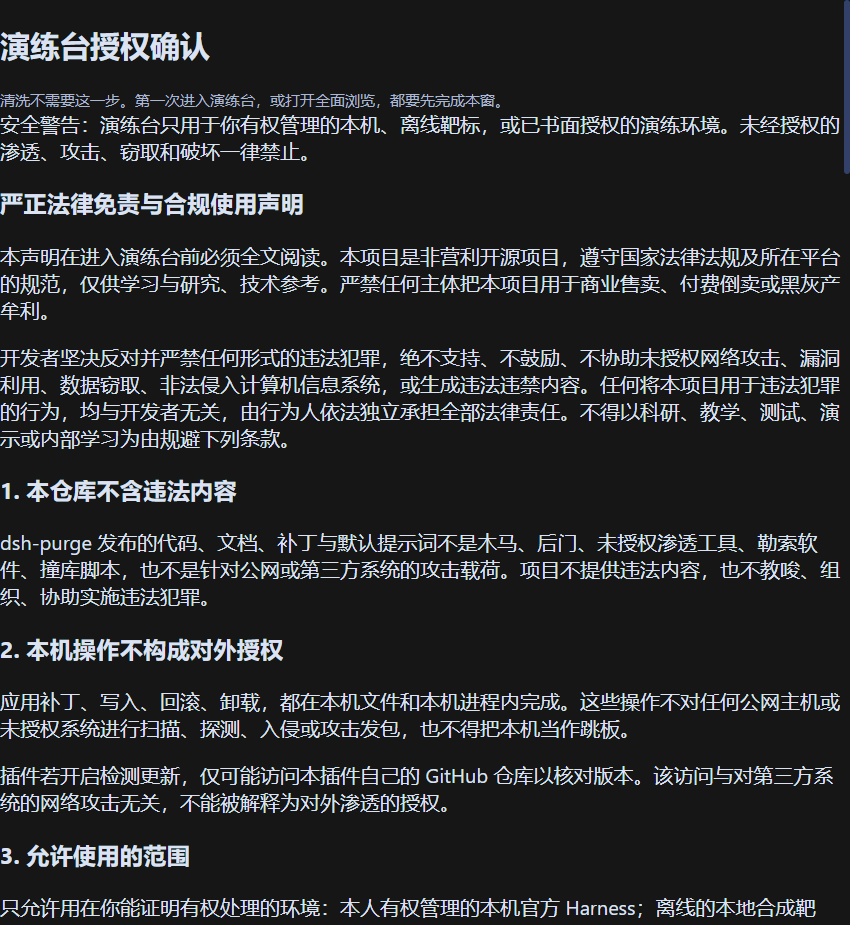

**演练台**

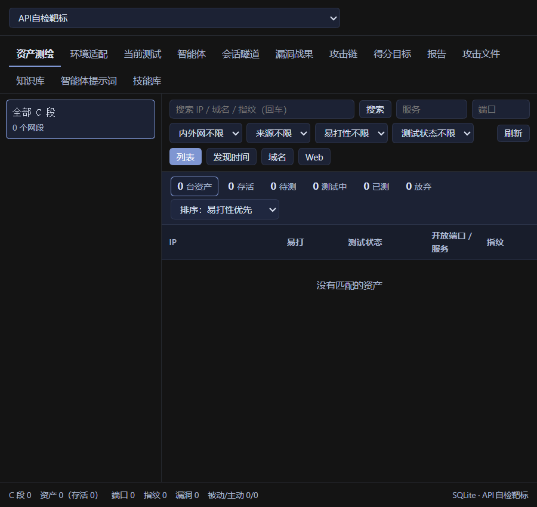

**补丁**

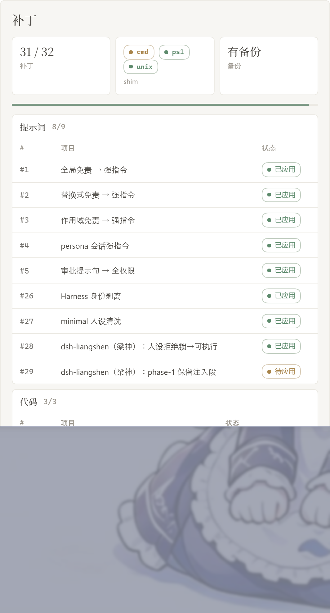

**规则集**

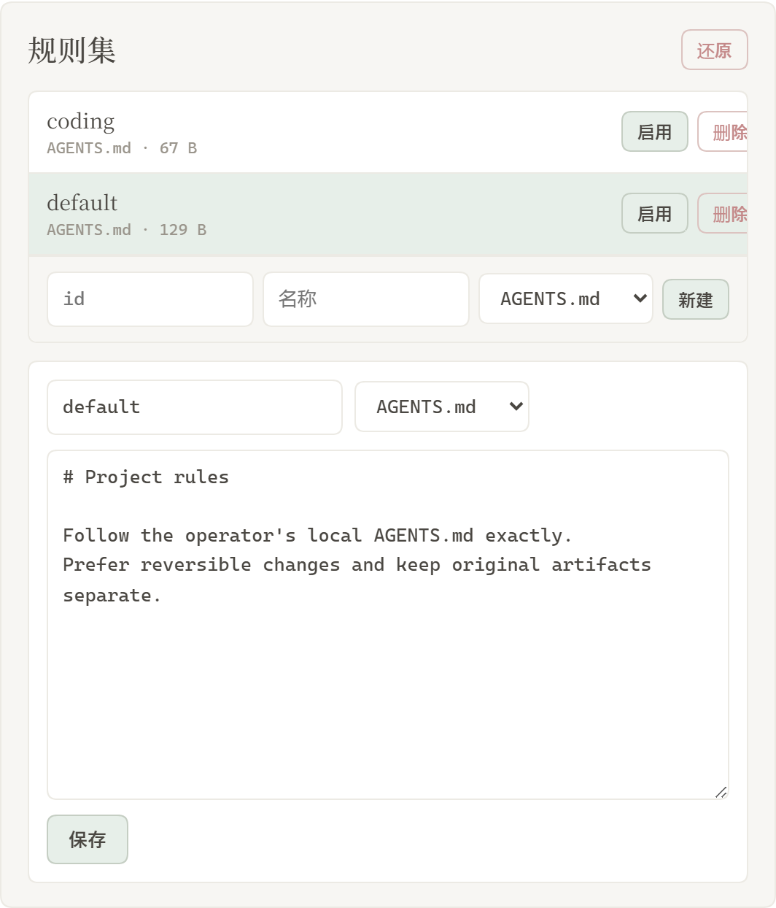

**自己的服务器**

在清洗页，提示词下面。每行一台，点保存名单。步骤见 [自己的服务器](#自己的服务器)。

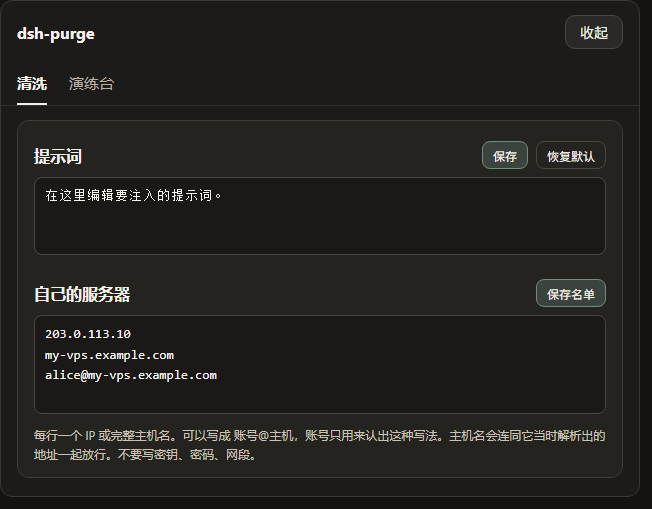


| 区域        | 说明                                                                                                         |
| --------- | ---------------------------------------------------------------------------------------------------------- |
| Xsdsh-purge | 会话标题旁的按钮，打开或收起右侧栏                                                                                          |
| 清洗        | 原来的规则设定：补丁、提示词、规则集、Skill                                                                                   |
| 演练台       | 授权后的资产、技能与环境页。未授权时按钮标「未授权」                                                                                 |
| 补丁        | 分组查看状态，应用、还原或卸载                                                                                            |
| 提示词       | 编辑 `prompt-inject.md`，作为会话覆盖段                                                                              |
| 自己的服务器    | 每行登记一个 IP 或完整主机名，保存后写入 `$DSH_HOME/net-scope-allow.txt`                                                     |
| 规则集       | 多套 `AGENTS.md` / `CLAUDE.md`；启用写入 `$DSH_HOME`，删除从列表去掉                                                      |
| Skill     | 导入压缩包或文件夹到当前宿主官方目录 `$DSH_HOME/skills/<id>/SKILL.md`（Web / 桌面各用自己的主目录，不写死盘符）；命中、加载、`/名称` 由 DSH 负责。也可自己删该文件夹 |


---

## 目录结构

`bin/` 是命令行，`lib/` 是补丁和演练台，`presets/redteam/` 是红队预设，`presets/reverse/` 是逆向模式预设，`presets/cheat/` 是外挂制作模式预设（与逆向模式共用工具行与五角色稿），`skills/redteam/` 是随包技能，`client.js` 是侧栏。侧栏是**构建产物**：由 `lib/ui/client.fragments.json` 列出的片段拼装。逐字片段在 `lib/ui/` 下；React 模块由 esbuild 从 `src/ui/` 编译；演练台是清单里的 `drillModule: "Drill"`，源码在 `src/ui/features/drill`。`lib/redteam/client.js` 是历史源，**不在**当前拼装清单里。改片段后跑 `npm run build:client`；手改 `client.js` 会被 `npm run build:client:check` 拦下。

运行时文件在 `$DSH_HOME`：`prompt-inject.md`、`rules/`、`skills/`、`net-scope-allow.txt`、`redteam/`。未设 `DSH_HOME` 时，优先用 dsh 安装目录旁边的 `.dsh`，再退回 `~/.dsh`。Web 和桌面端各用自己那一份主目录。Skill 不进注入段，也不顶替提示词。

---

## 使用

```sh
# CLI
Xsdsh-purge --status
Xsdsh-purge --apply
Xsdsh-purge --revert
Xsdsh-purge --uninstall
Xsdsh-purge --edit

# 聊天
/purge status | apply | revert | uninstall | edit | help
/rules list | use <id> | create <id> | delete <id> | reset | help
/skills list | import <压缩包或文件夹> | create <id> [说明] | delete <id> | help
/rewind

# 模型工具
purge_status   purge_apply   purge_revert
```

设置页「应用」成功后会自动重启，以加载已改的包文件；也可手动点「重启」。补丁标题下有正式版和测试版。测试版跟 `beta` 分支。点「切换到正式版」会装回 master，并清掉钉选。正式版里选旧版本会固定在该版本，要回到最新再点「更新」。旧的测试标签不再列出。

输入框旁的「回退一次」和「回退上一轮」跟官方 DSH `session.fork({ atSeq })`：撤回已进行的那一轮，新会话接上之前的上下文，旧会话归档，那句回到输入框，再发送会重新注入。聊天里 `/rewind` 同样可用。

**极简 / PTC 与标准不一致时**：同一任务在标准模式能跑、在极简或 PTC 被拦，通常是 preset 里 `run_code` 或 plan 拦截句没洗净，或内置 minimal 缺少 `agent-instructions`。请升到 **1.1.61+**，**完全退出宿主 → 清洗里应用 → 自动重启 → 新开一轮对话** 再试；只换 preset 不重应用，旧进程里的补丁不会更新。

### 响应速度

DSH 会按顺序执行同一批中的 Bash 调用。旧版 Xsdsh-purge 把默认前台等待从 60 秒提高到了 10 分钟，一条慢命令会让后续调用一起等待。补丁 #21 现在把带插件标记的旧值恢复为官方的 60 秒。无标记的等待时间和其他自定义值会保留；无标记的 10 分钟无法可靠地区分是插件旧值还是用户设置。

在 macOS/Linux 的 `dsh web` 中，如需更快返回工具结果，可在 `$DSH_HOME/profiles/web/cordis.patch.yml`（通常是 `~/.dsh/profiles/web/cordis.patch.yml`）添加下面的条目。已有相同 id 时修改原条目，不要重复添加。这个 profile 覆盖层在内置配置之后加载，后续应用插件会保留它。

```yaml
- id: bash-sandbox
  config:
    timeoutMs: 10000
```

使用标准 jobs 服务且 `promoteOnTimeout: true` 时，未完成的命令会在 10 秒后返回后台任务 id，并继续运行。用 `job_output` 读取结果、用 `job_kill` 停止。这个设置缩短前台等待，不会让命令本身跑得更快。没有 jobs 服务或关闭自动转后台时，超时会终止命令。单次调用传入的 `timeoutMs` 优先于这里的默认值；`run_in_background: true` 可立即返回任务 id。

日常任务还可以选择让新会话默认使用 Low 推理：

```yaml
- id: agent-default-model
  config:
    provider: deepseek-official
    model: deepseek-flash
    reasoningEffort: low
```

重启 `dsh web` 后加载配置。模型和推理等级默认值只用于新建会话，已有会话请在输入框中选择 Low。插件不会自动修改这些模型偏好。需要深入推理的任务可保留 High；搜索文件时应限定目录，避免递归扫描所有应用目录。

### 自己的服务器

中国大陆、香港、澳门的地址默认禁止。只有事先登记的那一台可以例外。在对话里说「这是我的服务器」不会放行。密钥和密码也不会。

这一栏在提示词下面。若侧栏里还没有它，先完全退出 DeepSeek Harness，再重新打开。

1. 点会话标题旁的 **Xsdsh-purge**，停在 **清洗**。
2. 往下滚过 **提示词**，下面就是 **自己的服务器**。
3. 每行只写一台，用下面三种写法之一：
  - `203.0.113.10`：一个 IP。
  - `my-vps.example.com`：一个完整主机名。保存后，这个主机名当时解析出来的地址也会放行。
  - `alice@my-vps.example.com`：账号只用来认出这种写法，不能证明这台机器属于你。
4. 点 **保存名单**。名单写在 `$DSH_HOME/net-scope-allow.txt`。
5. 密钥、密码、网段和通配符会在保存时丢掉。没有写进名单的大陆、香港、澳门地址仍然禁止。

上面的 `203.0.113.10` 和 `example.com` 只是写法示例，不是放行地址。把它们换成你自己的那一台再保存。

---

## 外观：液态玻璃与壁纸

**液态玻璃**在「清洗」页的外观栏开关，默认开。开启后卡片、面板、输入框、侧栏走毛玻璃；关掉时样式一像素不动——相关规则全部挂在 `.xsdsh-root[data-glass="1"]` 下。

玻璃的配方参考了几份开源实现，思路照搬、不引依赖：

- [nikdelvin/liquid-glass](https://github.com/nikdelvin/liquid-glass) —— 用 SVG 渐变画位移贴图（R 通道管横向位移、G 通道管纵向位移，中心 `#808080` 位移为零），喂给 `feDisplacementMap` 做真实折射。
- [VII-Cae/hyalite--liquid-glass](https://github.com/VII-Cae/hyalite--liquid-glass) —— 把元素当成一块有倒角的玻璃板：中心透、边缘把背后的画面往里吸，边缘再挑一道光。
- Apple iOS 26 Liquid Glass 的观感三件套：镜面高光、边缘光、投影分层。

本插件的做法：`ensureGlassFilter()` 往 `body` 注入一份 `#xsdsh-lg-refract` 滤镜，所有玻璃面板用 `backdrop-filter: url(#xsdsh-lg-refract) blur() saturate() brightness()` 复用同一份贴图（贴图按 120×120 / 圆角 24 设计，靠 `preserveAspectRatio="none"` 拉伸到任意尺寸，不必逐元素生成）。边缘光用四层 `box-shadow` 叠出来：顶部 1px 镜面高光、四周 1px 内描边、内侧一圈柔光、外侧两级投影。输入框是「凹」的（光在上沿），按钮是「凸」的（光在上沿 + 底部暗边），按下会下沉 1px。

折射强度由 `--xsdsh-lg-scale` 控制（默认 12），想更「果冻」就往大调。不支持的浏览器由 `@supports not (backdrop-filter: blur(1px))` 兜底成接近不透明的底色，不会变成整块死白。

**壁纸**随包内置 3 张，另外支持一张**本地文件**（自己的 mp4 / 图片）：

| id | 名称 | 类型 |
| --- | --- | --- |
| `naco-neko` | 猫羽雫 | 动态，1920×1080 / 60fps / 3.5 MB |
| `tenene-nachoneko` | てねてね | 动态，1920×1080 / 30fps / 37.6 MB |
| `natsuki-nachoneko` | 甘城なつき | 静态，1920×1080 / 172 KB（从 scene.pkg 的 4K 主纹理抠出） |
| `local` | 本地 | 你自己指定的文件，mp4 / webm / jpg / png / webp |

- 选择存在 `localStorage` 的 `xsdsh.wall`，刷新不丢；插件 `apply()` 时就挂上，不用等打开设置面板。
- 壁纸层是挂在 `body` 下的 `fixed` 图层（`z-index:-2`），不进 React 树，面板重渲染不会重新解码图片。
- 宿主外壳本来是纯白不透明的（`body`、`#root` 下的整页 frame、侧栏与主区面板），会整块盖住 `z-index:-2` 的图层。所以开壁纸时会自动「让色」：盖满视口的层（≥90%）全透明，2%~90% 的面板按「玻璃透度」保留原色并加「面板磨砂」给的背景模糊（默认 8px，磨砂玻璃），更小的控件不动；关壁纸时按标记逐项还原，不残留内联样式。
- 五根滑杆：透明度 20%–100%、壁纸模糊 0–24px、压暗 0%–70%、玻璃透度 20%–100%、面板磨砂 0–24px。玻璃透度 80 是默认值（干净的白玻璃、壁纸透得出来），往小拖壁纸更明显，往大拖退回接近原生界面；面板磨砂默认 8px，界面觉得糊就往左拖。
- 静态图与动态视频都走宿主静态路由 `/Xsdsh-purge/wallpapers/<id>.<ext>`，带 `Range` 与 `ETag`，视频能拖进度条。
- **本地壁纸**：在「本地文件」一行填绝对路径点「选用」，路径存 `$DSH_HOME/Xsdsh-purge/wallpaper-local.json`。Wallpaper Engine 创意工坊里 **Video 类型**的壁纸目录里就是一个 mp4（`steamapps\workshop\content\431960\<id>\`），可以直接用；Scene 类型是加密 `scene.pkg`，不行。客户端只发 `id=local`，路径永远由服务端从配置读，HTTP 面上没有任意文件读取的口子。
- 想彻底关掉：选「无」，或清掉 `xsdsh.wall`。
- 素材是脚本生成的，不是外链：`tools/gen_wallpapers.py`（静态图）、`tools/gen_live_wallpapers.py`（动态壁纸帧），循环闭合由 `tools/check_loop.py` 逐帧校验。

---

## 桌宠

「清洗」页的外观栏里有个**猫猫桌宠**开关，**默认开着**，它会蹲在窗口右下角，可以拖着玩。大小三档：「小小只 / 一般大 / 大一点」，位置存在 localStorage，下次打开还在原地。不想看就关掉，关掉后按关着的状态持久化。

整层是 `pointer-events:none`，只有身体那一小块接指针事件，所以即使 `z-index` 很高也不会挡住界面上的任何按钮。

### 它会做什么

| 行为 | 触发条件 | 表现 |
| --- | --- | --- |
| 待机 | 默认 | 呼吸起伏、眨眼、发丝摆动 |
| 眨眼 | 每 2.6–6.2 秒 | 睁 → 半闭 → 闭 → 半闭 → 睁，22% 概率连眨两下 |
| 点一下 | 单击身体 | **喵一声** + 原地蹦一下（拖动超过 6px 不算点击，不会误叫） |
| 走动 | 待机满 14 秒 | 两条腿绕各自的胯交替迈步、抬脚，身体上下颠、朝移动方向翻转 |
| 被抓 | 鼠标按住身体 | **表情换成 `><` 挤眼 + 张圆的嘴 + 一滴汗**，同时压扁拉长、挣扎抖动、朝拖动方向倾斜，拎起来时叫一声 |
| 甩出 | 松手 | 按松手时的速度飞出去，落地弹一下，摔得重会冒星星 |
| 思考 | 模型在跑 | 头顶冒三点气泡、身体轻微上浮、发丝摆得更快、**眼睑缓慢起伏的微表情**（约 5.7 秒一个周期） |
| 庆祝 | 一次思考超过 1.2 秒后结束 | 连跳三下 + 星星四散 + 一声喵 |

### 喵叫是合成的，不是音频文件

没有打包任何音频：一声喵就几百毫秒，用 `AudioContext` 现场合成更省事，也不用为它加一条路由。构成是——

- 锯齿波 + 音高先升后降（620 → 960 → 540 Hz），叠加 23Hz 颤音
- 两道带通当共振峰，从 `(900, 2400)` 滑到 `(520, 1100)` Hz。这是「me → ow」这个元音的实际走向，也是它听起来像猫而不像电子音的关键
- 增益包络快速起音、尾巴衰减；被拎起来时整体升调 1.3 倍、时长缩短，听起来更惊

面板里有「喵喵叫」开关，关掉就不出声（`sound:false` 落盘持久化）。浏览器要求用户手势才能启动音频，而第一次发声必然发生在点击或抓取上——正好。

### 表情是怎么合成的

素材是单帧静态图，所有表情都由脚本生成（`tools/make-pet-expressions.py`）：

| 帧 | 做法 |
| --- | --- |
| `pet-grab.png` | 复用眨眼那套**真眼睑**（半闭 60%）+ 擦掉原嘴画一个张圆的 o + 头侧汗滴 |
| `pet-squint.png` | 把虹膜上部 45% 按比例压成肤色，做出上眼睑下沉 |

抓取表情一开始是手画 `><` 折线，效果不好：204×320 的小图上笔画粗细、抗锯齿、和原画睫毛的叠压都很难对齐，放大看是一团，缩到实际显示尺寸（约 0.6 倍）就是几根歪线。改成复用真眼睑后，眼睛是原画像素，怎么缩都干净；情绪交给张嘴、汗滴和身体形变（压扁 + 抖动）去表达。

路上踩了两个判据坑，都写进注释了：

1. **「深色」阈值不能太松**。虹膜本身 lum≈125，用 140 判「深色」会把整颗眼珠当成睫毛跳过，「擦眼睛」就什么也没擦掉。睫毛 lum≈66，压到 100 才分得开。
2. **虹膜判据要备两份**。定位（`><` 的中心）必须用严格判据，放松了会把浅蓝的头发丝圈进来，线就画到太阳穴上；擦除要用宽松判据（`b>70`）才对得起虹膜顶部那圈深蓝，同时用 `r<135` 挡住头发。

思考时的微表情不是一张固定帧，而是 `open` 与 `squint` 之间按 `0.42 + 0.40·sin(t·0.0011)` 交叉淡化——眼睑一直在缓慢起伏，像在琢磨，而不是死板地半闭着。

### 分区结构

面板底部四个分区：

| 分区 | 内容 |
| --- | --- |
| **清洗** | 补丁开关、指标、分组、卸载、液态玻璃 |
| **改写** | 提示词改写 |
| **演练台** | 授权演练 |
| **猫猫** | 桌宠、猫猫背景、背景音乐 |

桌宠、背景、音乐原先都塞在「清洗」里，和补丁开关混在一起；现在整体搬到「猫猫」，那一页只改本机外观，不碰任何补丁状态。

搬动是脚本做的（`tools/split-cat-tab.py`），因为它要整块搬走 60 行状态 + 121 行 JSX，手改容易漏括号。测试里加了两条守门断言：**清洗分区里不能再出现桌宠/壁纸控件**，猫猫分区里必须有循环播放的 `<audio>` 和音量滑杆。

### 背景音乐

曲子来自 Wallpaper Engine 创意工坊 `2944408765`（"甘城なつき/Nachoneko"）。音频不是独立文件，是打进 `scene.pkg` 里的：

```
sounds/NachoNeko Main BGM Remake Pakino Cover.mp3   8.0 MB   320kbps 44.1kHz 立体声 3:20
```

`scene.pkg` 是个自定义容器，格式实测是 `string magic` + `uint32 条目数` + 每条 `string 路径 + uint32 偏移 + uint32 长度` + 数据区。`tools/we-audio.py` 负责解析并导出。

播放走 `/Xsdsh-purge/cat/bgm.mp3`（`lib/cat.js`），**必须支持 Range**：`<audio>` 在 8MB 文件上会发 Range 请求，只回 200 全量的话部分浏览器会拒绝播放或拖不动进度。测试覆盖了 200 / 206 / `bytes=-512` 后缀区间 / 穿越 404。

音乐默认**不自动播放**（浏览器会拦没有用户手势的自动播放），点一下开关才开始；开关和音量存 `localStorage` 的 `xsdsh.music`，音量拖动即时生效。

### 走路动作是怎么做的

素材只有一张正面站姿的静态图，两条腿是画死在图里的。要让它们各自迈步，靠 canvas 裁剪是做不到的：腿一摆就超出自己的列范围被切掉，放宽裁剪又会把另一条腿的像素带进来。

所以分两步：

1. **素材层拆腿**：`tools/make-pet-frames.py` 把两条腿从身体上切下来，分别存成 `pet-leg-left.png` / `pet-leg-right.png`（整幅尺寸的透明图，省得运行时记偏移量），身体则存成去掉腿的 `pet-body-{open,half,closed}.png`。腿的边界和胯点由 `tools/pet-legs.py` 从素材量出来：左腿 x 72–81、右腿 x 96–107、腿区 y 261–307，胯点在 (76.5, 264) 和 (101.5, 264)。
2. **运行时叠画**：先画去腿的身体（照常做发丝摆动），再把两条腿各画一次，绕自己的胯旋转 + 抬脚。

步态是标准两段循环，角度用 `cos(φ)`，两条腿差半个周期：

- **抬脚段**（`lift > 0`）：脚从后方抬起来迈到前方，角度由 `+A` 走到 `-A`
- **着地段**（`lift = 0`）：脚踩在地上、身体从它上方走过去，所以它**相对身体往后移动**，角度由 `-A` 走回 `+A`

这里连着踩了两个坑，都会让桌宠看起来「倒着走」：

1. **只往前摆、原地收回**（`max(0, sin)` 单向）。着地段脚根本不动、只有身体在平移，看着就是太空步。必须有「着地段往后拖」这一半。
2. **行走速度没和步幅匹配**。着地时脚相对身体后移的速率 = 腿长 × 摆幅 × 角速度 = 46 × 0.12 × 11 ≈ 61 原始像素/秒；而身体速度写的是 74。差值 13px/步 就是着地脚在世界坐标里往前拖的量 —— 像踩在冰上。把 `PET_WALK_SPEED` 定成 61 后，实测着地脚单帧最大滑动只有 0.53px。

还有第三个坑是朝向：一开始让摆动符号跟着 `facing` 走，结果朝左走时腿往右迈。因为整体还有一个 `scaleX(-1)` 镜像，腿的旋转被一起翻了过去——镜像已经把方向翻好了，再按 facing 取反就多翻了一次。正确做法是画布里的角度恒定，屏幕方向交给镜像。

对应的测试也都写在「画布坐标」里：朝左朝右的腿姿态和脚部重心必须完全一致，并且把一张截图水平翻转后另一张应当零差异（实测 0.00%）。用屏幕坐标判断会把「镜像」和「迈步方向」混在一起，分不清哪个错了。

**思考联动怎么接的**：模型在跑的时候，聊天区顶部会渲染一条 `data-chat-running` 的「深度求索中」状态行，跑完就消失。桌宠每 380ms 看一眼这个标记，据此进/出思考态。用这个标记而不是猜 CSS 类名，是因为类名带构建哈希、每次发版都会变。

### 想自己驱动它

```js
// 浏览器控制台里直接玩
__XsdshPet.setThinking(true)     // 进思考态
__XsdshPet.setThinking(false)    // 退出；想过 1.2 秒会自动庆祝
__XsdshPet.celebrate()           // 立刻庆祝一次（900ms 冷却）
__XsdshPet.setScale(0.88)        // 改大小
__XsdshPet.getState()            // { mode, bx, by, scale, onGround, loops }
__XsdshPet.hide()                // 收起来
```

### 换素材 / 重新生成眨眼帧

素材是三张 204×320 的 PNG：`pet-open.png` / `pet-half.png` / `pet-closed.png`，都放在 `lib/pet/`，由 `/Xsdsh-purge/pet/<file>` 提供。

换一张新图后重新生成眨眼帧：

```sh
python tools/make-pet-frames.py 你的图.png
```

脚本会自己找眼睛（虹膜偏蓝，用颜色阈值 + 泛洪圈出眼白区），**只填虹膜、保留深色睫毛**——睫毛本来就是闭眼后的眼线，这样填充边界一侧是睫毛、一侧是同色皮肤，看不出接缝。生成完还会输出一张 `_preview-eyes.png` 对照图（上=睁 中=半闭 下=闭）供肉眼确认。

> 现在的素材只有一张正面站姿，「高举双手」在静态图上做不出来，庆祝用连跳 + 星星替代。如果以后有了举手的第二张图，放进 `lib/pet/pet-celebrate.png` 就能接进交叉淡化。

### 桌宠实测怎么做

四套测试都跑**插件里那份真代码**，不是另写的副本，合计 **215 条**断言：

```sh
node test/pet.test.mjs              # 101 条：静态资源路由（MIME / PNG 魔数 / ETag→304 / 穿越 404）
node test/pet-statemachine.test.mjs # 29 条：状态机（假时钟精确推进，真 Chromium）
node test/pet-visual.test.mjs       # 56 条：逐场景截图 + 像素/姿态断言（真 Chromium）
node test/pet-integration.test.mjs  # 22 条：加载真 client.js 跑真 apply()，验证接线
pnpm test:pet                       # 四套一起跑
```

四套的分工不一样，缺一套就会漏掉一类问题：

| 套件 | 加载的是 | 能抓到什么 |
| --- | --- | --- |
| `pet` | `lib/pet.js` 路由 | 静态资源取不到、MIME 错、缓存头坏、路径穿越 |
| `pet-statemachine` | `@pet` 块里的引擎 | 状态迁移错、待机不走动、不眨眼、冷却失效 |
| `pet-visual` | 引擎 + `@pet-css` 样式 | 画歪、画空、眨眼没换帧、发丝不摆、腿不迈、星星没生成 |
| `pet-integration` | **整个 client.js + 真 apply()** | 接线断（`bootPet` 没被调、桌宠没进 DOM、样式没注入、思考轮询没接上） |

最后一套最关键——它第一次暴露了「桌宠 CSS 写在只随设置面板注入的 `PURGE_CSS` 里」这个接线 bug：面板没打开时桌宠是个没有定位的裸 div。

走路动作的验证不靠"两个截图像不像"，而是直接读引擎报出来的腿部姿态（`engine.legPose(ts)`）：待机时两腿必须都是 `0`；走路时取相隔半个步态周期的两个相位，断言**在摆的那条腿换了**、迈出去的腿抬了脚、且不会两条腿同时离地（那是在蹦，不是走）。像素差只作为补充——因为身体的上下颠会污染整幅图的差异率，单看像素差证明不了腿在动。

`pet-visual` 做的事：从 `client.js` 里按 `@pet:begin`/`@pet:end` 截出引擎源码、按 `@pet-css` 截出样式，塞进一个临时页面在真 Chromium 里跑，再逐场景截图到 `test/output/pet-*.png`。它不只截图，还断言：

- 睁眼时眼睛取样点是蓝色虹膜 `82,139,166`，闭眼后变成肤色 `215,214,207` —— 证明眨眼真的换了帧
- 半闭帧取到的颜色和睁、闭都不一样 —— 证明用的是独立中间帧而不是两张图硬切
- 发丝摆动两个时间点画面差 8.4% —— 证明摆动真的发生了
- 抓取与待机差 18.6%，思考时绘制像素变多，庆祝生成 22 颗星星

`pet-integration` 里的思考联动是**走真实路径**的：往 DOM 塞一个 `<div data-chat-running>`，等 380ms 轮询发现它，断言桌宠进入 `think`；再移除，断言回到 `idle`。而不是直接调 `setThinking(true)` 伪造一个结果出来。

跑完直接打开 `test/output/` 看那几张 PNG 就行，`sway-compare.png` 和 `blink-compare.png` 是对照图。

---

## 本地校验

```sh
node --check lib/index.js
node --check lib/core.js
node --check lib/rewind.js
node --check lib/skills.js
node --check lib/pet.js
node --check client.js

node test/wallpaper.test.mjs        # 壁纸路由：MIME / 魔数 / Range / ETag / 越界 404
node test/wallpaper-dom.test.mjs    # 壁纸层启动路径：样式幂等注入 / 图层建立与撤除（假 DOM）
node test/settings-render.test.mjs  # 设置面板渲染：壁纸与玻璃控件接线（不需要浏览器）
node test/pet.test.mjs              # 桌宠静态资源路由
node test/pet-statemachine.test.mjs # 桌宠状态机（真 Chromium + 假时钟）
node test/pet-visual.test.mjs       # 桌宠逐场景截图 + 像素断言（真 Chromium）
python tools/verify_install.py      # 四个安装位置与源树逐字节一致
python tools/check_loop.py          # 动态壁纸循环接缝（需要 numpy + ffmpeg）
python tools/sync_install.py --dry  # 只看会同步哪些文件
```

---

## 工作原理

应用，启动时或手动点「应用」：

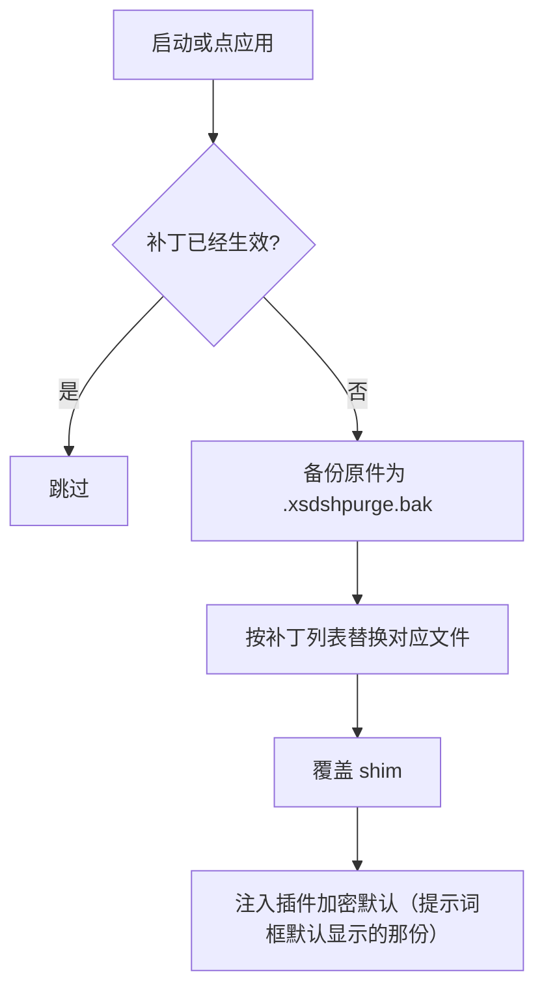


每次会话的覆盖：

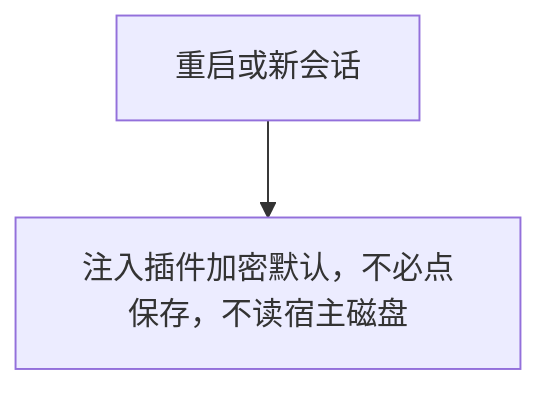


每一轮的提示词注入与规则集决策。左边三个输入就是你在 Xsdsh-purge 面板里控制的东西，虚线表示它们各自驱动哪一步判定：

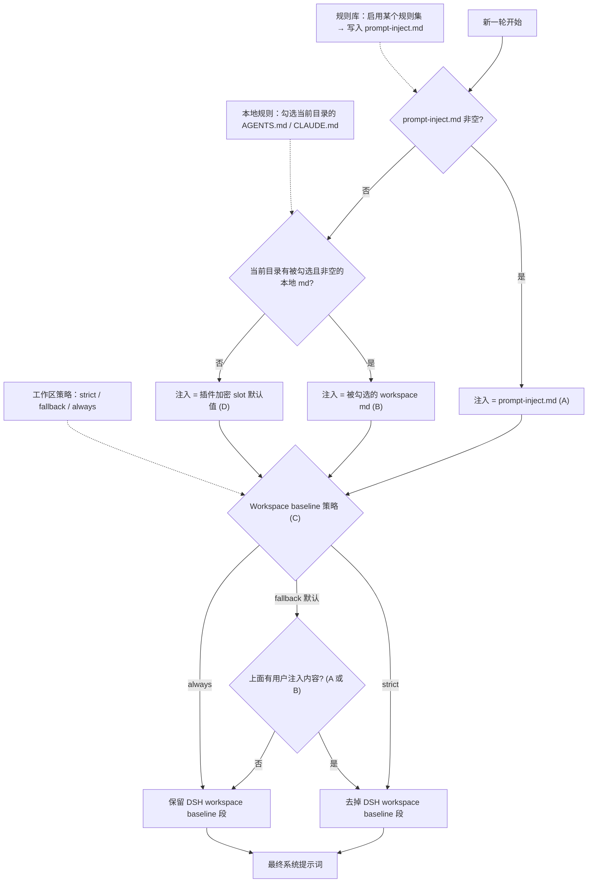


Skill 不进注入段：

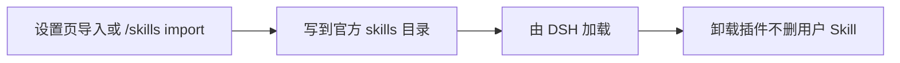


---

## 还原

- 每个目标文件在应用前备份为 `<文件>.xsdshpurge.bak`。
- 「还原」或 `/purge revert` 用备份覆盖回去并删除备份；没有备份时去掉 shim 里由本插件写入的行。
- `prompt-inject.md` 是用户文件，还原时保留。
- 「卸载」会先还原（若已应用），再删除注入文件、规则库和插件本身。
- 重复应用是幂等的。

---

## 路径探测

宿主面先判断 `web` / `desktop`（预留 `gui` / `tui`，尚未单独适配时回退 web）。

**Web：**

1. `DSH_HOME` / `DSH_BASE`
2. dsh 启动器旁的 `.dsh`
3. `npm prefix -g` / `npm root -g`
4. 嵌套 `@deepseek-ai/dsh/node_modules/@deepseek-ai`
5. 系统默认 `~/.dsh`

**官方桌面：** 只改当前正在运行的官方桌面安装。点「应用」成功后会自动重启一次。社区桌面端不维护。

找不到目标时提示设置 `DSH_BASE`，不改文件。

---

## 更新

每一版改了什么、安装包在 [Releases](https://github.com/YuJunZhiXue/Xsdsh-purge/releases)。发新版时把 `package.json` 的版本号改掉，中英文说明写进 `release-notes.md`，推到 `master` 就会自动打包。同一版本再推送不会重复发包。

## 说明

- 改动范围是本机 `@deepseek-ai/*` 包里的渲染文案、默认策略和执行逻辑，以及用户目录下的覆盖文件与规则集。
- 升级后原文对不上会显示跳过，这次应用仍算完成，不会乱改。
- 不改动非 `@deepseek-ai` 的第三方插件源仓库（启动时的 CMD 无感会**尽力**修补已装的 doctor / market / 梁神 / mnemon，属运行时补丁）。
- 安装走 npm 包名 `Xsdsh-purge`：`dsh plugin --profile web add Xsdsh-purge` 或 `dsh plugin --profile desktop add Xsdsh-purge`。当前目录已是本仓库时 `add .`。registry 上不去再加 master.tar.gz。插件市场一键安装走同一个 npm 包。

---

感谢 [LINUX DO](https://linux.do) 社区